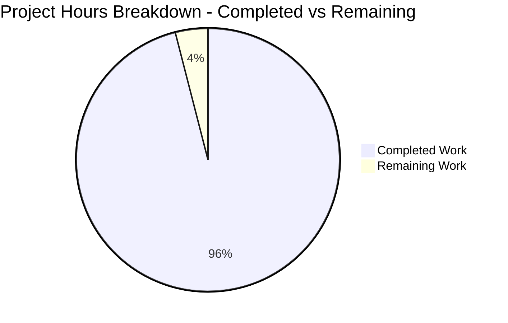
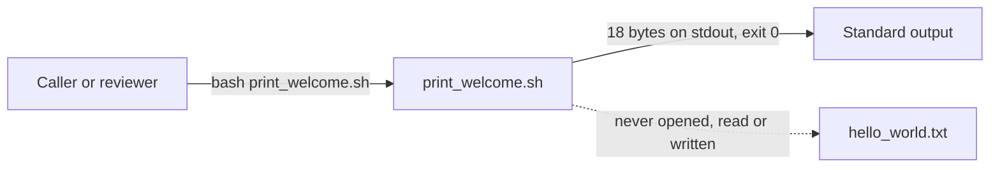

# 1. Executive Summary

This is the release assessment for the two-file `Welcome to Blitzy` deliverable: what was built, what was exercised to prove it works, what no test covers, and what remains open.

## 1.1 Project Overview

The project delivers two artefacts at the repository root: `print_welcome.sh`, a one-line program that writes `Welcome to Blitzy` plus a line feed to stdout and exits zero, and `hello_world.txt`, a plain-text file holding that line exactly 90 times as authored content. Its users are the requester and any automated check of its output. Value lies in literal fidelity and brevity: the text must be exactly what was asked for, the file must be content rather than code output, and nothing may be added to make the repository look complete. Scope is one shell runtime, with no framework, service, port, configuration, dependency or build step.

## 1.2 Completion Status

Every requirement the specification sets is delivered and reproduced; the outstanding hours are two path-to-production steps.



| Metric | Value |
|---|---|
| Total Hours | 25.0 |
| Completed Hours (AI + Manual) | 24.0 |
| Remaining Hours | 1.0 |
| **Completion** | **96%** (24.0 ÷ 25.0) |

## 1.3 Key Accomplishments

- `print_welcome.sh` prints `Welcome to Blitzy` unformatted: 18 bytes, one line feed, exit 0 (`print_welcome.sh:1`).
- `hello_world.txt` holds that line exactly 90 times as authored content: 1620 bytes, one distinct line (`hello_world.txt:1-90`).
- The program never reads, writes, counts or names the data file, so the two artefacts are independent.
- No code in the repository generates the data file, and a scan proves it, failing closed on planted violations.
- The deliverable is zero-dependency and byte-exact under every environment, locale, argument set and concurrency level exercised.

## 1.4 Critical Unresolved Issues

Open items: 1 of the 2 deliverables the request names carries a caveat; nothing blocks release.

| Issue | Impact | Owner | ETA |
|---|---|---|---|
| `print_welcome.sh` carries no world-readable mode through version control | A checkout under a restrictive umask (077) presents the script as 0600, so a non-owner reader or runner fails with `Permission denied` until `chmod 644`; no content, output or contract effect | Repository owner / DevOps | Before verifying or distributing a clone |

## 1.5 Access Issues

No access issues identified. The deliverable needs no credentials, API keys, database or network access.

## 1.6 Recommended Next Steps

1. **[Medium]** Confirm the modes on a fresh checkout (`stat -c '%a %n' print_welcome.sh hello_world.txt`) and run `chmod 644 print_welcome.sh` if it is not world-readable.
2. **[Medium]** Run the twelve proving commands and both acceptance gates as the release acceptance pass, recording the two digests; repeat on any change.
3. **[Low]** Keep the no-generator scan in every review, so the file's literal-content guarantee stays enforced.
4. **[Low]** Publish the contract where contributors look, and add no README, comment, shebang, manifest or fixture — each would break the minimality budget or the no-generation rule.

# 2. Project Hours Breakdown

Hours are stated for the specified work only: every hour below traces to a requirement of the specification or to a step needed to put the two artefacts into a releasable state.

## 2.1 Completed Work Detail

Each component traces to named requirements of the specification; the verification components carry the exactness contract and its proving commands, which are in scope and are the project's stated quality bar.

| Component | Hours | Description |
|---|---|---|
| `print_welcome.sh` — program artefact and its contract | 4.0 | One line, 23 bytes (`echo Welcome to Blitzy`): exactly 18 bytes to stdout, exit 0, no shebang, comment, quoting, option, redirect, handler or diagnostic, and no reference to the data file. FR1, FR5, NFR1, NFR2, §0.5.3, §0.6.1, §0.7.2, §0.12.1 |
| `hello_world.txt` — literal data file | 4.0 | 90 identical authored lines, 1620 bytes, LF-terminated throughout, one distinct line, no CR, no BOM, committed as content with no producer anywhere in the tree. FR2, FR3, NFR3, §0.5.1, §0.6.1 |
| Exactness verification | 6.0 | The proving command set and its expected values, byte-exactness proofs, the falsifier matrix of defective variants, the repository-wide generator scan and the manifest/lockfile/CI absence check. NFR4, §0.5.2, §0.5.4, §0.8.1, §0.12.2 |
| Independence and environment validation | 4.0 | Artefact separation, thirteen file-state variants, invocation, environment, locale and argument sweeps, concurrency and side-effect freedom. FR4, NFR4, NFR5, NFR6, §0.3.2 |
| Repository end state and scope discipline | 3.0 | Root holding exactly the two deliverables, no manifest, lockfile, CI, scaffold or executable bit, and removal of the platform-seeded stub with no compensating file. FR5, §0.4, §0.7.1, §0.7.2, §0.8.2, §0.9.1, §0.10 |
| Release readiness | 3.0 | Both deliverables committed, clean working tree, index modes and digests recorded, and every acceptance value reproduced from a fresh clone. Path to production |
| **Total** | **24.0** | |

## 2.2 Remaining Work Detail

No requirement of the specification contributes remaining hours: every one is delivered and reproduced. Both outstanding items are path-to-production steps.

| Category | Hours | Priority |
|---|---|---|
| Path to production — confirm the checkout's working-tree file mode and normalise it where a restrictive umask has left `print_welcome.sh` non-world-readable | 0.5 | Medium |
| Path to production — release acceptance pass on the checkout: re-run the twelve proving commands and both acceptance gates and record the two digests before distribution | 0.5 | Medium |
| **Total** | **1.0** | |

## 2.3 Estimation Basis and Confidence

Hours are engineering effort for the specified work, not elapsed time, and they are concentrated where the deliverable's difficulty actually lies: verification accounts for 10 of the 24 completed hours because an exactness contract has no value until its counts, bytes and prohibitions are provably reproduced. Confidence is **high** for the two artefact components, the exactness verification and release readiness — each is fully specified and was measured directly — and **medium** for the two residual items, whose duration depends on the consuming team's umask and on how it runs an acceptance pass rather than on anything in the repository. No component is estimated by analogy, and none is padded.

# 3. Test Results

The repository deliberately contains no test framework, suite or fixture — a fixture that wrote the data file would breach the no-generation rule — so its quality bar is the proving command set, and the figures below are the checks actually executed against these two files. No coverage tooling exists in a zero-dependency project, so coverage is reported as not applicable.

| Area / Category | Framework | Tests | Passed | Failed | Coverage | What This Proves |
|---|---|---|---|---|---|---|
| Program stdout and exit contract | Bash harness (`cmp`, `od`, `wc`, `$?`) | 172 | 172 | 0 | n/a | Every in-contract invocation writes exactly the 18-byte greeting and exits 0 |
| Program behaviour across environments, locales, arguments and failure paths | Bash harness, pty, restricted interpreter | 145 | 145 | 0 | n/a | Output is invariant to environment and input, and the exit status is the only failure signal |
| Data-file values and shape | Bash harness (`wc`, `grep`, `awk`, `sort`, `od`) | 122 | 122 | 0 | n/a | The file holds the string 90 times in 90 LF-terminated 17-character lines, 1620 bytes |
| Data-file determinism, mutation and falsifier matrix | Bash harness plus 12 defective variants | 182 | 182 | 0 | n/a | Content is invariant under execution, and every defective variant is caught rather than passing |
| Independence, repeatability and concurrency | Bash harness, parallel and storm runs | 73 | 73 | 0 | n/a | The program never touches the data file, and output is identical under concurrent load |
| Formal acceptance gates and the twelve proving commands | Bash (`per-change` check, whole-package gate, proving set) | 14 | 14 | 0 | n/a | The published acceptance criteria pass as written on the delivered files |
| **Total** | | **708** | **708** | **0** | | |

**Not covered by any test**

- **Direct execution** (`./print_welcome.sh`) is outside the documented contract — there is no shebang and no executable bit — so it is not covered and fails with `Permission denied` (exit 126). Only `bash print_welcome.sh` is covered.
- **Caller-controlled interpreter startup**: with `BASH_ENV` set, the shell reads that file before the program's command runs, so an injected `echo` function can replace the greeting. This is documented shell behaviour rather than program behaviour, no hardening is in scope, and it is not covered as a supported path.
- **Non-ASCII locales** are not installed on the host, so locale-sensitive behaviour was exercised only through the shell's fallback path; stdout stayed at 18 bytes under every locale setting.
- **Automated regression**: nothing guards the printed text or the 90-line count between changes, so a future edit is unverified until the proving command set is re-run.
- **The no-generation rule** is enforced by re-running a scan, not by any mechanism in the repository; a later commit adding a generator, task or fixture would not be caught until that scan runs again.
- **File mode after checkout** is not covered by any test: version control records only the executable bit, so a clone under a restrictive umask presents the script as 0600.

# 4. Runtime Validation & UI Verification

- ✅ **Program invocation** — `bash print_welcome.sh` prints `Welcome to Blitzy`, 18 bytes byte-exact, exit 0, 0 bytes on stderr.
- ✅ **Output on a terminal** — the greeting appears with no escape sequences; the only carriage return in a terminal transcript is the terminal's own translation.
- ✅ **Argument and locale independence** — none to 5000 arguments, shell-metacharacter, unicode and 100,000-character arguments, and five locale settings: identical 18 bytes every time.
- ✅ **Environment independence** — empty environment, empty and nonexistent `PATH`, hostile `echo`/`cat`/`printf` placed earlier on `PATH`, 2000 variables, restricted interpreter and a 4-descriptor limit: identical output.
- ✅ **Data-file independence** — with the file absent, empty, one byte, mode 000, random bytes, a directory, a symlink, a dangling symlink, a FIFO with no writer, a read-only directory and from three working directories: identical output, no hang, and the path is never opened.
- ✅ **Repeatability and concurrency** — ten sequential runs, fifty to two hundred concurrent runs and a three-hundred-run storm produced one distinct output and left the data file's digest unchanged.
- ✅ **Failure signalling** — unwritable or closed stdout exits 1 and a closed pipe exits 141, with no text emitted by the program itself.
- ✅ **Repository end state** — no generator construct, no manifest, lockfile or CI file, no executable bit and no placeholder marker; a fresh clone runs correctly and leaves the tree clean.
- ⚠ **Direct execution** — `./print_welcome.sh` is outside the documented contract and exits 126 with `Permission denied`; invoke the script as `bash print_welcome.sh`.

**Never exercised at runtime:** there is no browser, user interface, HTTP surface, server, port, database, queue or network integration — none exists in the repository, so none was driven and no screenshot or session recording exists. The deliverable's only runtime surface is the shell: an 18-byte stdout stream and its exit status, both exercised.

# 5. Compliance & Quality Review

The deliverable is judged against two things: the exactness requirements the request states, and the engineering benchmarks that apply to any code handed over — output fidelity, interface integrity, data hygiene, verifiability, scope control, security baseline and production readiness.

## 5.1 Compliance Matrix

| Deliverable / Requirement | Benchmark | Status | Verified State |
|---|---|---|---|
| Byte-exact output (NFR1) | Output fidelity | ✅ PASS | stdout is exactly 18 bytes, `cmp` exits 0, digest `2dc7e85a…` |
| Exit-status contract (NFR2) | Interface integrity | ✅ PASS | exit 0 on every success path; failure paths exit 1 or 141 with no program text |
| Literal content, no producer (FR3) | Data integrity | ✅ PASS | committed content equals working content; generator scan exits 1 with no match |
| Artefact independence (FR4) | Design hygiene | ✅ PASS | no path reference in the program; 13 file states leave output identical |
| Minimality and zero dependency (FR5) | Footprint control | ✅ PASS | 1 line / 23 bytes; no manifest, lockfile, dependency, import or scaffolding |
| Determinism and encoding hygiene (NFR3) | Data hygiene | ✅ PASS | 1620 bytes, LF on every line, one distinct line, 0 CR, no BOM, no padding |
| Reproducible verification (NFR4) | Verifiability | ✅ PASS | all twelve proving commands and both acceptance gates reproduce their stated values |
| No security surface (NFR6) | Security baseline | ✅ PASS | no input, file, socket, secret, environment variable or configuration read |
| Repository end state and scope discipline (§0.7, §0.8) | Scope control | ✅ PASS | root holds exactly the two deliverables; every excluded artefact absent |
| No placeholder or stub content | Production readiness | ✅ PASS | marker scan returns no match; the program is one complete, working command |
| Interface documented (§0.12.2) | Documentation | ✅ PASS with caveat | the contract is documented in the specification and this guide, not in the repository, by design |
| Engineering convention (§0.12.1) | Convention compliance | ✅ PASS (sanctioned departures) | shebang, quoting, comment, error handling, tests and documentation omitted where each would cost a line, a byte or the required format |

## 5.2 AAP & Rule Divergences and Gaps

No user rules were provided for this project, so no divergence from a user rule is possible; the departures below are differences between the specification's own text — or general engineering convention — and what the codebase or its environment actually presents.

| What the AAP / Rule Required | What Was Delivered Instead | Why It Diverged | Impact | Remediation |
|---|---|---|---|---|
| §0.9.1: the repository root was empty and its file plan carries no DELETE entry — no existing file was read, modified or removed | The platform-seeded 46-byte `README.md` stub was removed with no replacement (commit `231449d`; `git diff ca750d6 --name-status` = `D README.md`, `A hello_world.txt`, `A print_welcome.sh`) | The premise is factually wrong: the baseline commit tracked that stub. §0.7.1, §0.7.2 ("Documentation files: none"), §0.8.2 and proving command 11 all require a root holding exactly the two deliverables, so the higher-ranked sections were followed | None on the artefacts; the root now matches the structural sections. Undoing it would put the tree in breach of four requirements at once | None. Do not re-create the README or add a compensating file; a future specification revision should describe the root's actual starting contents |
| §0.2.3 / §0.3.1 / §0.5.4 name the toolchain: bash 5.2.21, GNU coreutils 9.4, grep 3.11, diffutils 3.10, findutils 4.9.0, python 3.12.3, perl 5.38.2 | The host provides bash 5.3.9, uutils coreutils 0.10.0, grep 3.12, diffutils 3.12, findutils 4.10.0, python 3.13.18, perl 5.40.1 (node v22.23.4 and mawk 1.3.4 match) | The toolchain is platform-provided and was used as found; the specification is frozen, and its environment table records the image it was written against | None: neither artefact carries, reads or depends on a version, and every stated count and digest reproduces on the installed tools | None required. Refresh the environment table when the specification is next revised |
| §0.2.3 and §0.8.2: `file` and `xxd` "are not installed", so no verification may depend on them | `/usr/bin/file` is present on this host; `xxd` is genuinely absent | Same platform-provided toolchain; the exclusion it supports is unaffected | None: no proving command names or needs either tool, and byte inspection throughout used `od -c` | None. A future verification instruction should not treat `file` as unavailable |
| §0.5.4 command 11 expects the root to list the two deliverables plus `.git` | The root also holds the platform's `blitzy/` evidence directory — untracked, empty (0 files) and invisible to version control | It is platform scaffolding created outside this work, not a deliverable; the tracked tree is exactly the two files | None on the deliverable; only an exact root-listing assertion would read it as unexpected | None in the repository. Automation should assert the two deliverable paths and the manifest count rather than exact listing equality |
| General engineering convention expects a code comment, error handling or diagnostic, defensive quoting, a shebang or entry point, a test suite and repository documentation | None of them exists: the program is a single unquoted `echo`, and the repository holds no test, manifest, README or documentation file | The request's own instructions — print the text "without any format" and use "as less lines as possible by optimizing token usage" — plus §0.5.3 (1 line / 23 bytes), §0.12.1 (the convention is outranked here), §0.12.2 (no coverage target) and §0.8.2 (tests, documentation, shebang and executable bit excluded) | A comment or shebang would break the 23-byte budget, a diagnostic would emit exactly the output format the request excludes, and a fixture writing the data file would breach the absolute no-generation rule. The cost is that the contract is documented outside the repository | None. Adding any of them would breach the specification; publish the contract where contributors look instead |

**Why the README removal is a recorded departure rather than a defect.** The specification's file plan was written on the belief that the repository root was empty; the initial commit shows a 46-byte, two-line platform stub in that position. Every substantive section that describes the end state — the proposed structure, the file-path rules, the out-of-scope list and the proving command that counts manifest and CI files — requires a root whose only content is `print_welcome.sh` and `hello_world.txt`. Removing the stub is therefore what the specification's intent demands, and it is recorded here because a reader comparing the plan's file table against the repository would otherwise see an unexplained deletion. The decision is settled: nothing in the tree references the removed file (`grep -r -i readme` finds no match), no replacement was created, and re-creating it would break four requirements simultaneously.

**Why the environment differences need no action.** The version literals and the `file`/`xxd` claim describe the image the specification was authored against, not this host. Nothing in either artefact reads a version or invokes an external tool — `echo` is a shell builtin, and the data file is plain content — so no byte of the deliverable changes with the toolchain. The requirement those literals support, that every stated count is reproducible with the tools actually installed, was verified directly: all twelve proving commands reproduce their stated values on the installed tools, and byte inspection used `od -c` rather than a tool that might be absent. What remains is editorial: the specification's environment table should be re-measured rather than restated when it is next revised.

**Why the exact root listing cannot be asserted.** The platform's `blitzy/` directory — holding an empty `screenshots/` and an empty `screen_recordings/` — sits beside the two deliverables and `.git`. It is untracked, holds no file, is created by the platform rather than by this work, and never reaches the delivered tree. A reviewer replaying the proving command verbatim and comparing the whole listing would read it as an unexpected fourth entry; asserting the two deliverable paths plus the manifest count gives the same guarantee without the false signal. No change inside the repository could remove it, and no change should.

**Why the omitted conventions are sanctioned rather than missing work.** The request asked for the string to be printed with no formatting and in as few lines as possible, and named no documentation, test or packaging artefact. A comment or a shebang costs a second line and breaks the 23-byte budget that is itself a requirement; an error banner or a diagnostic would print exactly the "format" the request excludes; a defensive `set -e` would be a line of code the deliverable does not need; a test fixture that wrote the data file would breach the prohibition that the file's 90 lines are authored content. The conventions were therefore outranked deliberately, and the compensating documentation is this guide and the specification. A future contributor should treat the absences as requirements, not as gaps to fill.

# 6. Risk Assessment

Risks below are forward-looking: what could still go wrong once these files are in use, not the events of delivery.

| Risk | Category | Severity | Probability | Mitigation | Status |
|---|---|---|---|---|---|
| The no-generation rule is enforced by process, not by any mechanism in the repository: a later commit could add a loop, task, CI step or fixture that writes `hello_world.txt` | Technical | Medium | Medium | Keep the repository-wide generator scan in every change review, and re-run the proving command set on any change to either file | Open (process) |
| No automated suite guards the printed text or the 90-line count, so a future edit is unverified until the command set is re-run | Technical | Medium | Medium | Treat the twelve proving commands plus the two acceptance gates as the required pre-merge check for any change to `print_welcome.sh` or `hello_world.txt` | Accepted by design |
| The file mode does not travel through version control: a checkout under a restrictive umask presents `print_welcome.sh` as 0600 and non-owner readers or runners fail with `Permission denied` | Operational | Medium | Medium | `chmod 644 print_welcome.sh` after checkout, or clone under umask 022; assert the mode in any environment setup | Accepted (environment property; reproduced from a fresh clone) |
| The exit status is the whole failure signal, and the only failure text is the interpreter's own — a caller that ignores the status has no other indication | Operational | Low | Medium | Callers must test `$?`; the invocation contract is documented in Section 9 | Accepted by design |
| A caller-controlled `BASH_ENV` or `SHELLOPTS` changes interpreter startup, so an injected `echo` function can replace the greeting | Security | Low | Low | Pin the invocation environment where the output feeds an exact comparison; no in-scope defence exists, and none is owed | Accepted (documented shell semantics) |
| Automation asserting exact root contents, or a consumer expecting the platform-seeded README stub, will read the repository as unexpected: the stub is gone and the platform evidence directory is present | Integration | Low | Medium | Assert the two deliverable paths plus the manifest count, never exact listing equality; treat the stub's removal as settled | Mitigated |
| The interface contract lives outside the repository — no README, comment or usage text — so a new contributor has to look further to learn the invocation, output and file shape | Maintainability | Low | High | Publish the contract where contributors look (Section 9 restates it); do not add a README, comment or usage text inside the repository | Accepted by design |

# 7. Visual Project Status


**Reading the chart.** 24 of 25 hours are complete — 96% — and the two remaining items are path-to-production steps: confirming, and where necessary normalising, the working-tree file mode on a fresh checkout, and running a release acceptance pass of the twelve proving commands and both gates on that checkout (0.5 h each, Medium priority). These remaining hours are identical to the Section 2.2 total and to the Remaining Hours figure in Section 1.2; completed and remaining together account for every hour of the project.

Because both outstanding items sit in one category, a breakdown by category would say nothing the table in Section 2.2 does not already give.

# 8. Summary & Recommendations

The project is **96% complete** against the specification's scope (24 of 25 hours), and everything that remains is operational rather than unfinished code. Both artefacts the request names exist at the repository root, exactly as specified: `print_welcome.sh` is one line and 23 bytes, prints `Welcome to Blitzy` with no formatting as exactly 18 bytes on stdout and exits zero; `hello_world.txt` holds that same line 90 times as authored literal content, 90 LF-terminated lines and 1620 bytes, with one distinct line, no carriage returns and no byte-order mark. Nothing other than those two files is tracked.

What was exercised to prove it is a deliberately small but deep verification surface, because an exactness contract is worth nothing until its counts are reproduced. The program's output was compared byte-for-byte and its exit status read on every invocation path, including terminals, pipes, files, an empty environment, hostile `PATH` entries, restricted interpreters, five locales, thousands of arguments and hundreds of concurrent runs. The data file was measured against every stated value, mutated into twelve defective variants to confirm the checks fail closed, and re-measured after roughly a thousand invocations to confirm no execution can create, append to or regenerate it. The repository-wide scan for generator constructs returns no match, the manifest, lockfile and CI check returns zero, and a fresh clone prints the greeting and leaves the tree clean. In total 708 executed checks pass with no failures.

The remaining gaps are small and precisely stated. The literal-content guarantee is enforced by re-running a scan rather than by any mechanism inside the repository, so it must stay in the review process; no automated suite guards the printed text or the 90-line count; and the file mode does not travel through version control, so a checkout under a restrictive umask presents the script as 0600 until `chmod 644`. The contract is also documented outside the repository by design — there is no README, comment or usage text — which is a deliberate consequence of the request's minimality instruction, not an oversight.

The critical path to production is therefore two short steps on a fresh checkout: confirm the modes with `stat -c '%a %n' print_welcome.sh hello_world.txt` and run `chmod 644 print_welcome.sh` where needed, then run the twelve proving commands and both gates as the release acceptance pass and record the two digests. There is no dependency to install, no configuration to supply, no service to start, no port to open, no database to migrate and no deployment target to reach — the deliverable ships as two committed files.

Production readiness: **ready**, with the mode caveat above and the standing rule that the generator scan and the proving commands accompany any future change. Success for this project is measured by literal fidelity rather than by throughput or availability: the string appears character-for-character in the output and exactly 90 times in the file, every count survives independent re-measurement, and no part of the repository can produce the data file it is supposed to carry.

# 9. Development Guide

## System Prerequisites

- **GNU bash 5.x** on the path (`/usr/bin/bash`; verified on bash 5.3.9). Run every command under `bash`, not `sh` — `/bin/sh` is dash, which rejects `$'\r'` and process substitution used by the verification steps.
- **Standard text utilities**, already present on any Linux or macOS host: `wc`, `sort`, `tr`, `od`, `grep`, `awk`, `cmp`, `diff`, `find`, `sha256sum`.
- **Nothing else.** No package manager, dependency, manifest, lockfile, compiler, virtual environment, container or database is involved. `xxd` is not installed on this host, so byte inspection uses `od -c`.

## Getting Started

```bash
# 1. Clone the project and enter it
git clone <repository-url> print-welcome
cd print-welcome

# 2. Confirm what is tracked — exactly two files
git ls-files
# hello_world.txt
# print_welcome.sh

# 3. Confirm the file modes; under a restrictive umask the script may arrive as 0600
stat -c '%a %n' print_welcome.sh hello_world.txt
# 644 print_welcome.sh
# 644 hello_world.txt
chmod 644 print_welcome.sh   # only if the line above showed 600

# 4. Check the script parses
bash -n print_welcome.sh
# (no output, exit 0)
```

## Running the Program

```bash
bash print_welcome.sh
# Welcome to Blitzy
```

The contract is exactly three facts: the invocation `bash print_welcome.sh`; the stdout it produces — `Welcome to Blitzy` followed by one line feed, 18 bytes, nothing before or after; and the exit status 0.



There is no shebang and no executable bit, so run the script by naming the interpreter. `./print_welcome.sh` fails with `Permission denied` (exit 126) — that is the contract, not a fault. There is no `--help`, no option, no argument and no configuration: any argument is ignored and the greeting is still printed.

## Verifying the Deliverable

Run these from the project root. Every expected value below was produced on this host.

```bash
# Program: exact output, size and exit status
bash print_welcome.sh | wc -c                        # 18
bash print_welcome.sh | cmp - <(printf 'Welcome to Blitzy\n')   # no output; exit 0
bash print_welcome.sh > /dev/null; echo $?           # 0
wc -l < print_welcome.sh                             # 1
wc -c < print_welcome.sh                             # 23
diff <(printf 'echo Welcome to Blitzy\n') print_welcome.sh       # no output; exit 0

# Data file: 90 lines of the string, 1620 bytes
wc -l < hello_world.txt                              # 90
grep -c -x -F 'Welcome to Blitzy' hello_world.txt     # 90
wc -c < hello_world.txt                              # 1620
sort -u hello_world.txt | wc -l                       # 1
grep -c $'\r' hello_world.txt                         # 0 (exit 1 when there are no matches)
od -c hello_world.txt | tail -2                       # … t z y \n  — the last line is terminated
sha256sum hello_world.txt
# fee3199434af8e9c2a80683cfa8fcffe627719a39354012617ec5d7b5d23f539

# Repository: no generator, no manifest, no lockfile, no CI
grep -r -I -n --exclude-dir=.git -E "open\(|write|append|>>|\bfor\b|\bwhile\b|\bseq\b|range\(|\byes\b|tee |xargs" .
# (no output; exit 1 — the pass)
find . -not -path './.git/*' -type f | sort           # exactly the two deliverables

# The program does not touch the data file
bash print_welcome.sh > /dev/null; sha256sum hello_world.txt   # digest unchanged, 1620 bytes, 90 lines
```

## Example Usage

Capture the greeting in a script and compare it, which is how the output is designed to be consumed:

```bash
line=$(bash print_welcome.sh)
[ "$line" = "Welcome to Blitzy" ] && echo "greeting OK"

# Chain it into a byte-exact check
bash print_welcome.sh | cmp - <(printf 'Welcome to Blitzy\n') && echo "18 bytes, byte-exact"

# Count the file's occurrences without reading the program
grep -c -x -F 'Welcome to Blitzy' hello_world.txt
```

## Environment Notes

Nothing is configured through the environment: the program reads no variable, no `.env` file exists and no setting changes its output. It runs identically under `env -i`, with an empty `PATH`, and with a restricted interpreter. Keep that in mind when comparing output — a caller-supplied `BASH_ENV` or `SHELLOPTS` is read by the shell itself before the script runs and can add text around the greeting.

## Troubleshooting

| Symptom | Cause | Resolution |
|---|---|---|
| `Permission denied`, exit 126, when running `./print_welcome.sh` | The script has no shebang and no executable bit — direct execution is outside the contract | Run `bash print_welcome.sh` |
| A non-owner reader or runner gets `Permission denied` while the repository looks correct | The clone materialised under a restrictive umask; version control records only the executable bit | `chmod 644 print_welcome.sh`; clone under umask 022 for a shared checkout |
| `wc -l < hello_world.txt` prints 89 and `wc -c` prints 1619 | The final line's newline was lost (the exact-line count may still read 90) | Restore the terminating line feed; re-check with `od -c hello_world.txt \| tail -2` |
| `wc -c < hello_world.txt` prints 1710 and the exact-line count prints 0 | The file was saved with CRLF endings | Save with LF endings only |
| `wc -l < print_welcome.sh` prints 2 or `wc -c` prints 25, 29 or 35 | A shebang, a comment, a blank line, quoting or a `printf` form was introduced | Restore the single line `echo Welcome to Blitzy`; compare with `diff <(printf 'echo Welcome to Blitzy\n') print_welcome.sh` |
| The greeting prints a literal `\n` | The line was written as `echo Welcome to Blitzy\n`, which emits a backslash and an `n` | Remove the backslash |
| `cmp` reports a difference of one byte | The output is 17 bytes (no newline) or 19+ bytes (something was added) | Confirm the line is the single `echo` command and that no wrapper or logging surrounds the invocation |
| An argument appears to do nothing | By design: the program reads no input and prints the same greeting regardless | None needed |
| A root-listing assertion fails on an extra entry | This checkout carries a platform-maintained, untracked, file-free evidence directory | Assert the two deliverable paths and the manifest count rather than exact listing equality |

# 10. Appendices

### A. Command Reference

Run every command from the project root, under `bash`.

| Purpose | Command | Expected result |
|---|---|---|
| Run the program | `bash print_welcome.sh` | `Welcome to Blitzy`, exit 0 |
| Count output bytes | `bash print_welcome.sh \| wc -c` | `18` |
| Prove byte-exactness of output | `bash print_welcome.sh \| cmp - <(printf 'Welcome to Blitzy\n')` | no output, exit 0 |
| Read the exit status | `bash print_welcome.sh > /dev/null; echo $?` | `0` |
| Check the script parses | `bash -n print_welcome.sh` | exit 0 |
| Program line and byte counts | `wc -l < print_welcome.sh; wc -c < print_welcome.sh` | `1`, `23` |
| Program content check | `diff <(printf 'echo Welcome to Blitzy\n') print_welcome.sh` | no output, exit 0 |
| Data-file line count | `wc -l < hello_world.txt` | `90` |
| Data-file logical line count | `awk 'END{print NR}' hello_world.txt` | `90` |
| Occurrences of the exact line | `grep -c -x -F 'Welcome to Blitzy' hello_world.txt` | `90` |
| Data-file byte count | `wc -c < hello_world.txt` | `1620` |
| Distinct lines | `sort -u hello_world.txt \| wc -l` | `1` |
| Carriage-return bytes | `grep -c $'\r' hello_world.txt` | `0` (exit 1 — the pass) |
| Line terminators | `od -c hello_world.txt \| tail -2` | last bytes `t z y \n` |
| Data-file digest | `sha256sum hello_world.txt` | `fee3199434af8e9c2a80683cfa8fcffe627719a39354012617ec5d7b5d23f539` |
| Generator scan (must find nothing) | `grep -r -I -n --exclude-dir=.git -E "open\(\|write\|append\|>>\|\bfor\b\|\bwhile\b\|\bseq\b\|range\(\|\byes\b\|tee \|xargs" .` | no output, exit 1 |
| Tracked files | `find . -not -path './.git/*' -type f \| sort` | the two deliverables |
| File modes | `stat -c '%a %n' print_welcome.sh hello_world.txt` | `644` for each in a standard clone |

### B. Port Reference

No port is bound. The deliverable starts no service, daemon, server or container and opens no socket; there is nothing to expose, forward or firewall.

### C. Key File Locations

| Path | Role |
|---|---|
| `print_welcome.sh` | The program: 1 line, 23 bytes, invoked as `bash print_welcome.sh` |
| `hello_world.txt` | The data file: 90 authored lines of `Welcome to Blitzy`, 1620 bytes |
| `.git/` | Version control; not a deliverable |
| `blitzy/` | Platform-maintained evidence directory, untracked and empty; not a deliverable |

### D. Technology Versions

| Tool | Version in use | Role |
|---|---|---|
| GNU bash | 5.3.9 (`/usr/bin/bash`) | The only runtime the deliverable needs |
| GNU grep | 3.12 | Exact-line counts, carriage-return detection, the generator scan |
| uutils coreutils | 0.10.0 (`wc`, `sort`, `tr`, `od`, `sha256sum`) | Line and byte counts, distinct lines, byte inspection, the digest |
| mawk | 1.3.4 | The terminator-independent line count |
| GNU diffutils | 3.12 (`cmp`, `diff`) | Byte-exact comparison of stdout and of the script |
| GNU findutils | 4.10.0 | Proving no manifest, lockfile or CI configuration exists |

Not used by the deliverable, though present on the host: Python 3.13.18, Node v22.23.4, perl 5.40.1. `xxd` is absent, so `od -c` is used for byte inspection.

### E. Environment Variable Reference

None. The deliverable reads no environment variable, needs no `.env` file and has no configuration surface; it produces identical output under `env -i`. The only environment variables that can affect a run are the shell's own startup settings (`BASH_ENV`, `SHELLOPTS`), which are read by the interpreter before the script executes and are not part of the program's contract.

### F. Developer Tools Guide

| Task | Tool and approach |
|---|---|
| Read the program | It is one line — `cat print_welcome.sh` or `cat -A print_welcome.sh` to see the terminating newline |
| Inspect exact bytes | `od -c <file>` and `od -An -tx1 <file>`; `xxd` is not installed on this host |
| Prove two outputs are identical | `cmp a b` (byte-wise) rather than `diff`, which is line-based and tolerates a missing final newline |
| Count lines safely | Use `wc -l` **and** `awk 'END{print NR}'`: the first counts terminators and the second counts the final partial line too |
| Inspect a text file's shape | `sort -u <file> \| wc -l` for distinct lines; `grep -c $'\r' <file>` for carriage returns; `awk 'length($0)!=17' <file>` for off-length lines |
| Verify integrity after a change | `sha256sum hello_world.txt` against the reference digest in Appendix A |

### G. Glossary

| Term | Meaning |
|---|---|
| AAP | The project's approved technical specification: the requirements this assessment measures against |
| Byte-exact | Identical byte for byte, including the final line feed — proved with `cmp`, not `diff` |
| Data file | `hello_world.txt`: authored content carrying the line 90 times, with no producer anywhere in the repository |
| Generator | Any code path — loop, pipeline, template, build or task step, fixture or script — that would create or regenerate the data file; prohibited absolutely |
| Literal content | Text written into the file and committed as content, never computed, expanded or produced by code |
| LF | Line feed (`0x0A`), the terminator on every line of both files |
| Minimality budget | The binding size limits: 1 line / 23 bytes for the program, 1620 bytes for the data file |
| Proving command set | The twelve published commands, with their expected values, that establish every claim about the two artefacts |
| Working-tree mode | The POSIX permission bits a checkout materialises; version control records only the executable bit, so a restrictive umask yields 0600 |
